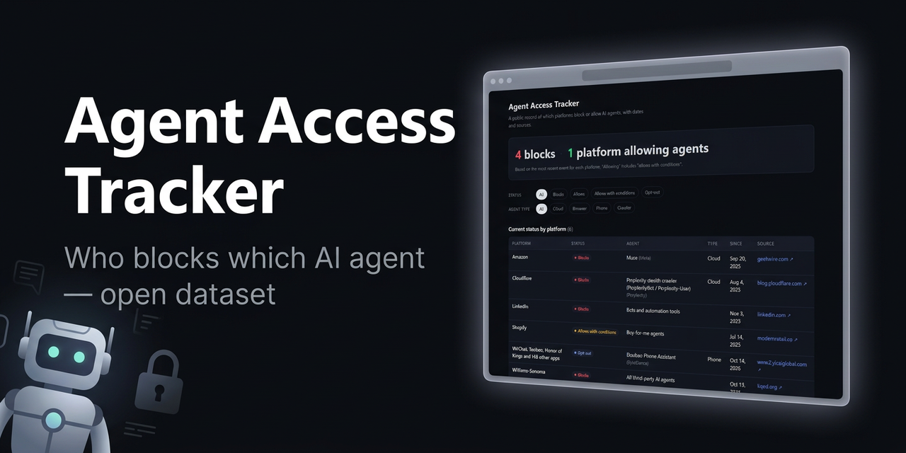
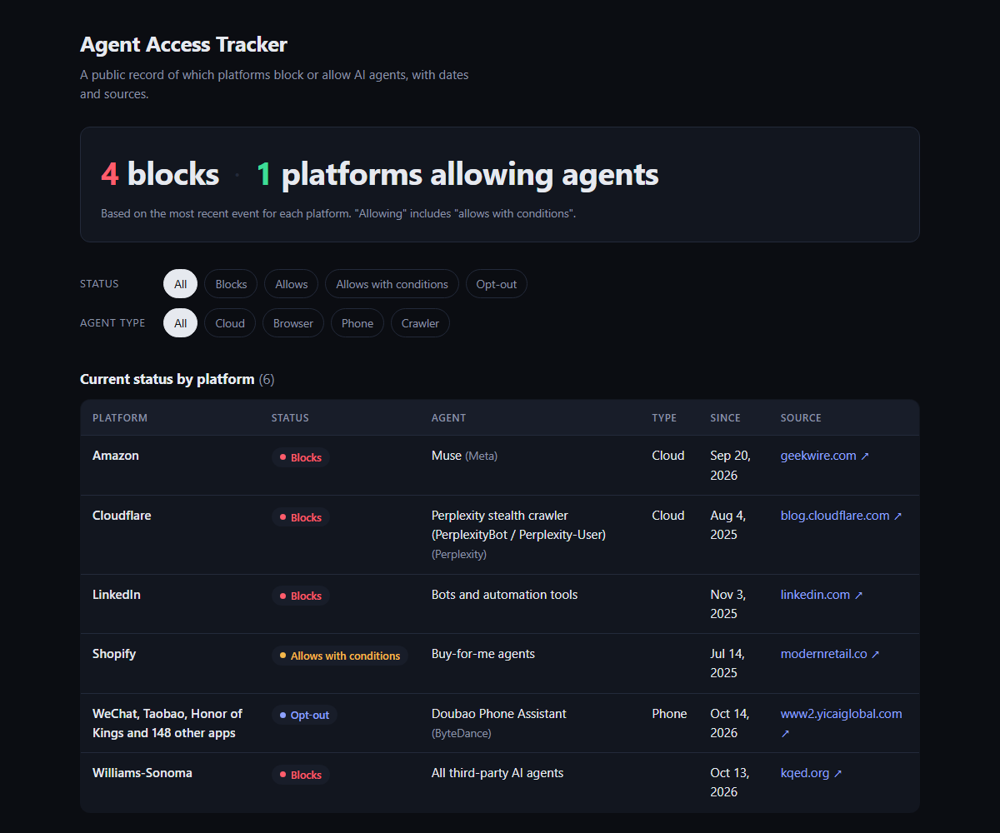

# 🛡️ Agent Access Tracker

**A public, sourced record of which platforms block or allow AI agents, and when.**

🌐 **Live page:** https://neirenl.github.io/agent-access-tracker/

📅 **Last updated:** 2026-10-28

## 🧭 Why this exists

AI agents now browse, compare and buy on people's behalf, and platforms are deciding, often quietly, whether to let them in.
Those decisions are scattered across robots.txt files, terms of service, blog posts and lawsuits.
This project collects them in one dated, sourced place, so anyone can see who blocks what and how it changes over time.

---

## 📊 The data

The data lives in two files. In [`data/events.csv`](data/events.csv), each row is one **event**: a platform changed (or announced) its stance toward an agent. The page shows the most recent event per platform as its current status.

| Column | Meaning | Allowed values / format |
|---|---|---|
| `date` | Date of the event | `YYYY-MM-DD` |
| `platform` | Platform taking the action | e.g. `Amazon`, `LinkedIn` |
| `country` | Country of the operational headquarters of the company that **operates the site or app** (not the holding company or its legal seat, not the agent's country, and not where the platform is used). If the legal seat is elsewhere, it goes in `notes`. | Two-letter [ISO 3166-1](https://en.wikipedia.org/wiki/ISO_3166-1_alpha-2) code, e.g. `US`, `MX`, `CN`. `GLOBAL` only if there is no clear operator. A platform keeps the same country in every row. |
| `agent` | The AI agent affected | e.g. `Comet Assistant`, `Grok Bot` |
| `agent_company` | Company behind the agent | e.g. `Perplexity`, `xAI` |
| `agent_type` | Where the agent runs | `cloud` · `browser` · `phone` · `crawler`. Leave empty if the source doesn't say. |
| `status` | The platform's stance | `blocks` · `allows` · `allows with conditions` · `opt-out` |
| `mechanism` | How it is enforced | `robots.txt` · `terms of service` · `technical block` · `permission protocol` · `network/CDN block` · `lawsuit`. Leave empty if the source doesn't say; put details in `notes`. |
| `verification` | How the event is confirmed | `official` · `media report` · `user reports` |
| `source_url` | Link to the source | Full `https://` URL |
| `notes` | Extra context | Free text (wrap in quotes if it contains commas) |

### Agents

[`data/agents.csv`](data/agents.csv) explains each specific agent named in `events.csv`, plus agents on a watchlist that have no events yet: one row per agent. Every value comes from an official company page, doc or blog; anything the official source doesn't give is `unknown` (or `no data` for availability). Groups of agents (for example "All third-party AI agents") are not a specific product, so they get no row; the page shows them in italics.

| Column | Meaning | Allowed values / format |
|---|---|---|
| `agent` | Agent name, as written in `events.csv` | e.g. `GPTBot`, `Muse` |
| `company` | Company behind the agent | e.g. `OpenAI` |
| `type` | Where it works | `cloud` · `local` (on the user's device) · `crawler` · `unknown` |
| `type_source` | Where `type` comes from | `official` (the source states it) · `inferred` (deduced from the source; the page shows it as "likely") · `unknown` when `type` is `unknown` |
| `what_it_does` | What it does, in one simple line | Free text |
| `user_agent` | Name it uses in robots.txt, or `none` if it browses like a normal Chrome browser | e.g. `ChatGPT-User` |
| `launch_date` | Launch date | `YYYY-MM-DD` or `unknown` |
| `source_url` | Official source(s) | `https://` URLs separated by ` ; `, or `unknown` |
| `available_countries` | Where the agent is available, only from official help pages or docs (never from news) | Two-letter codes separated by `;` (e.g. `US;MX`), `GLOBAL`, or `no data` (no official list) |
| `excluded_countries` | Countries the official source says are excluded | Codes separated by `;`, or `no data` |
| `availability_source_url` | Official page the countries come from | `https://` URL, or `no data` |
| `availability_source_type` | Kind of page | `help_page` · `changelog` (the page shows "per changelog") · `none` |
| `availability_notes` | Exceptions the codes can't express (e.g. excluded regions of a country) | Free text, may be empty |
| `checked_date` | When the availability page was checked | `YYYY-MM-DD` |
| `tracking` | Why the agent is listed | `event` (named in `events.csv`; the check fails if no event names it) · `watchlist` (watched before any event; the page shows "Watching (no events yet)") |

## 🤝 How to contribute

Know of a platform blocking or allowing an AI agent? **[Open an issue](https://github.com/NeirenL/agent-access-tracker/issues/new/choose)** and include:

1. The platform and the agent
2. What happened (blocks, allows, conditions, opt-out) and the date
3. **A link to the source.** This is required. Official announcements, terms of service, or reputable media are best.

Entries without a verifiable source won't be added. If you spot an error or a dead link, open an issue too.

Editing the CSV directly? Every push and pull request runs an automatic check on `data/events.csv` and `data/agents.csv` (exact columns, `YYYY-MM-DD` dates, allowed values, `https://` sources, no duplicates). If it fails, the log tells you which line to fix. `agent_type` and `mechanism` may be left empty when the source doesn't say.

Every Monday, an automated check visits each `source_url` and opens an issue if any link is broken.

Every Monday, the robots.txt watcher in [`watch/`](watch/) also checks the sites listed in `watch/sites.txt` and saves their robots.txt snapshots in [`snapshots/`](snapshots/). It opens an issue when the rules for AI agents change, and never edits `data/events.csv` itself.

## 📄 License

The data and content in this repository are licensed under [**Creative Commons Attribution 4.0 International (CC BY 4.0)**](https://creativecommons.org/licenses/by/4.0/). You are free to share and adapt them for any purpose, as long as you give appropriate credit:

> Agent Access Tracker, https://github.com/NeirenL/agent-access-tracker (CC BY 4.0)
